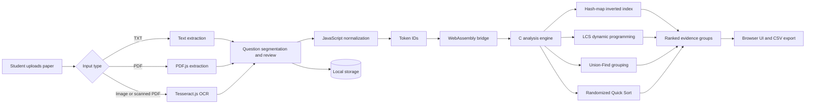

# PAPERPULSE: A DSA-BASED PAST QUESTION PAPER ANALYSIS SYSTEM

<p align="center">
  <strong>Find recurring questions. Understand the evidence. Revise smarter.</strong>
</p>

<p align="center">
  <a href="https://barathvasan-dev.github.io/paperpulse-dsa-mini-project/">▶ Watch the video demonstration</a>
  ·
  <a href="https://github.com/barathvasan-dev/paperpulse-dsa-mini-project">View source</a>
</p>

PaperPulse is a browser-based academic mini project that analyzes past question papers and identifies recurring questions across multiple source papers. It combines a JavaScript interface, a C analysis engine compiled to WebAssembly, and local browser storage to provide a private, install-free study workspace.

> **Project title:** PAPERPULSE: A DSA-BASED PAST QUESTION PAPER ANALYSIS SYSTEM

## Project highlights

| Area | Implementation |
| --- | --- |
| Input | Plain text, PDF, image, and OCR-based extraction |
| Analysis | Token normalization and ordered similarity |
| Grouping | Transitive recurring-question groups |
| Output | Ranked evidence view and CSV export |
| Runtime | Browser, WebAssembly, and local storage |
| Privacy | Papers are processed locally on the device |

## Problem statement

Students often review several previous question papers manually to find repeated topics and questions. This process is slow, difficult to compare consistently, and can miss paraphrased questions that use different wording. PaperPulse addresses this problem by extracting questions, normalizing their text, measuring ordered similarity, grouping related questions, and ranking the results by evidence across source papers.

## System architecture



The browser handles extraction, review, normalization, rendering, and storage. The C engine receives validated integer token IDs through WebAssembly and returns group membership, distinct-paper frequency, and known-mark totals.

## Features

- Import plain-text, PDF, PNG, JPEG, WebP, and BMP question papers.
- Extract questions and review their wording, topics, marks, paper name, and year.
- Compare questions using token normalization and longest common subsequence similarity.
- Group recurring questions with Union-Find (Disjoint Set Union).
- Rank question groups by distinct source-paper coverage and known marks.
- Search and filter ranked questions.
- Export the current ranking as CSV.
- Run entirely in the browser with local storage; uploaded source files are not sent to a server.

## DSA algorithms used

The project’s main contribution is the use of classical Data Structures and Algorithms to turn unstructured past papers into ranked revision evidence.

The analysis engine in [`engine/pulse.c`](engine/pulse.c) uses:

| Algorithm / data structure | Purpose in PaperPulse | Complexity |
| --- | --- | --- |
| **Chained hash-map inverted index** | Finds candidate question pairs that share normalized tokens without comparing every pair blindly. | Expected `O(1)` bucket lookup; `O(P)` worst case for a bucket with `P` postings |
| **Longest Common Subsequence (LCS)** | Measures how much of two questions appears in the same order. Similarity is `2 × LCS / (length A + length B)`. | `O(m × n)` per comparison |
| **Union-Find / Disjoint Set Union** | Merges matching pairs transitively, so related questions form one recurring group. Uses path compression and union by size. | `O(alpha(Q))` amortized; `O(Q)` worst case without the heuristics |
| **Randomized Quick Sort** | Ranks groups by distinct-paper coverage, known marks, and component ID. | Expected `O(g log g)`; `O(g^2)` worst case |

The compiled WebAssembly engine is included at [`dist/pulse.wasm`](dist/pulse.wasm), so no build step is required for normal use.

Here, `Q` is the number of questions, `W` is the maximum normalized question length (at most 128 tokens), `P` is the number of postings in a hash bucket, and `g` is the number of groups. Candidate generation can still approach quadratic behavior when many questions share common tokens; the inverted index reduces unnecessary pair checks but does not guarantee sub-quadratic analysis for every dataset.

## Ranking and similarity

PaperPulse uses similarity as a grouping gate, not as the final ranking score:

1. Normalize each question into a sequence of token IDs after Unicode normalization, lower-casing, and stop-word removal.
2. Compute `similarity = 2 × LCS length / (token count A + token count B)`.
3. Join a pair when its similarity meets the configurable threshold (70% by default).
4. Merge joined pairs transitively with Union-Find.
5. Rank each resulting group by:
   - **Distinct-paper frequency:** number of different source papers containing the group.
   - **Known marks:** sum of marks for all occurrences; missing marks contribute zero.
   - **Component ID:** deterministic tie-breaker based on input order.

Thus, a group appearing in four papers ranks above one appearing in two papers, even if the second group has more total marks. Similarity determines membership; paper frequency and marks determine rank.

## Worked example

Suppose three papers contain these questions:

| Paper | Question |
| --- | --- |
| Paper 2023 | Explain binary search tree traversal |
| Paper 2024 | Explain traversal in a binary search tree |
| Paper 2025 | Describe graph traversal using BFS |

After normalization, the first two questions share most tokens in the same order and meet the configured LCS threshold. They are joined into one group by Union-Find. The BFS question remains separate because its token sequence does not meet the threshold.

The first group is shown as **2 distinct papers** and is ranked using its total known marks. The second group has **1 distinct paper**. The ranking does not claim that the first group is more similar than the second; it reports that it has stronger recurrence evidence across papers.

## Run locally

### Requirements

- Windows 10 or later
- Python 3 for the local HTTP server
- A current browser such as Chrome, Edge, or Firefox
- Zig 0.14.1 only if rebuilding the WebAssembly engine

### Windows

Double-click [`Start PaperPulse.cmd`](Start%20PaperPulse.cmd), then open <http://127.0.0.1:8174/>.

### Command line

From the project directory:

```powershell
python -m http.server 8174 --bind 127.0.0.1 --directory dist
```

Open <http://127.0.0.1:8174/> in a browser. Serving through localhost enables browser storage, workers, and WebAssembly.

The GitHub Pages link is a **video demonstration**, not a hosted interactive application. The application itself is run locally with the command above.

## Try the sample data

The [`sample-data/`](sample-data/) directory contains six plain-text past-paper examples. Import them one at a time through **Paper library**, review the extracted questions, and select **Save and analyze**.

## Project structure

```text
paperpulse-dsa-mini-project/
├── dist/                 # Browser application, WebAssembly, OCR, and PDF assets
├── engine/pulse.c        # C analysis engine
├── sample-data/          # Sample past question papers
├── screenshots/          # UI screenshots
├── output/               # Example CSV export
├── docs/                 # GitHub Pages video player
├── Start PaperPulse.cmd  # Windows launcher
└── README.md
```

## Build the WebAssembly engine

If Zig 0.14.1 is installed, rebuild the included engine from the project directory:

```powershell
zig build-exe engine/pulse.c -target wasm32-freestanding -O ReleaseSmall -fno-entry --export=reset --export=input --export=analyze --export=ranked --export=group --export=coverage --export=score --export-memory -femit-bin=dist/pulse.wasm
```

## Screenshots and demo

### Application screens

The screenshots below are intentionally sized for readability in the GitHub page. Full-resolution files are available in [`screenshots/`](screenshots/).

<p>
  <strong>Workspace</strong><br>
  
</p>

<p>
  <strong>Paper library</strong><br>
  
</p>

<p>
  <strong>Question ranking</strong><br>
  
</p>

<p>
  <strong>Algorithm lab</strong><br>
  
</p>

### Video demonstration

<p align="center">
  <a href="https://barathvasan-dev.github.io/paperpulse-dsa-mini-project/"><strong>▶ Play the PaperPulse video demonstration</strong></a>
</p>

The [GitHub Pages video player](https://barathvasan-dev.github.io/paperpulse-dsa-mini-project/) provides native browser playback using the hosted MP4.

- [`output/paperpulse-rankings.csv`](output/paperpulse-rankings.csv) is an example ranking export.

## Testing

The project is a static browser application. Before publishing a change, perform this smoke-test checklist:

1. Start the server with the Windows launcher or the Python command.
2. Open the application and create a subject collection.
3. Import at least two sample papers from [`sample-data/`](sample-data/).
4. Review and save the extracted questions.
5. Open **Question rankings**, inspect a recurring group, change the similarity threshold, and reanalyze.
6. Switch to **Paper coverage** and export the ranking CSV.
7. Confirm that the application reloads with the saved collection in the same browser.

The checked-in WebAssembly binary and browser assets are the release build used by the demo.

## Future enhancements

- Add automated unit tests for segmentation, normalization, ranking, and CSV export.
- Add browser end-to-end tests for importing, reviewing, saving, and exporting papers.
- Support more OCR languages and improved multi-column document extraction.
- Add optional topic-based filtering and trend visualizations.
- Provide a hosted interactive deployment with a privacy-preserving storage strategy.
- Add benchmark data to measure candidate reduction and LCS performance on larger collections.

## Privacy and limitations

PaperPulse processes papers on the device. Reviewed data is stored in this browser's local storage for this site. Original uploaded files are discarded after extraction. Clearing site data removes the collection. There are no accounts or cross-device backups.

Current limits are 25 MB per upload, 60 pages per PDF, 600 questions per subject, and 128 normalized tokens per question. OCR, mathematical notation, and multi-column layouts should be reviewed manually.

## License

This project is provided as an educational mini project. Add a license file before redistributing it publicly.
