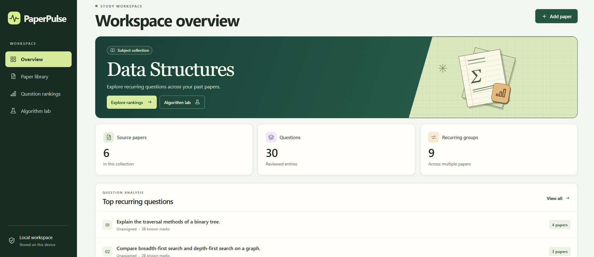
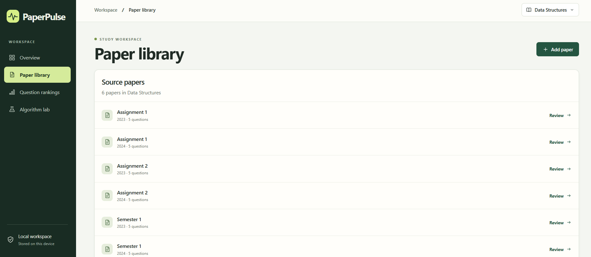
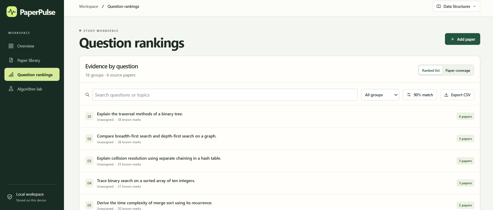
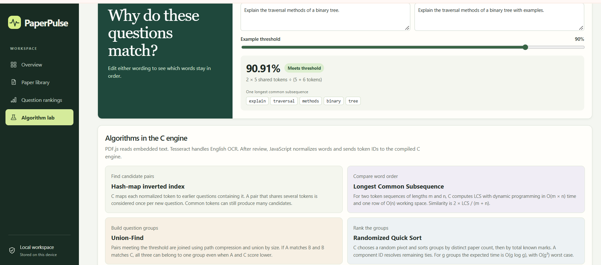

# PAPERPULSE: A DSA-BASED PAST QUESTION PAPER ANALYSIS SYSTEM

PaperPulse is a browser-based mini project that helps students review past question papers, identify recurring questions, and inspect evidence across source papers. It demonstrates practical Data Structures and Algorithms concepts through a local-first study workspace.

## Features

- Import plain-text, PDF, PNG, JPEG, WebP, and BMP question papers.
- Extract questions and review their wording, topics, marks, paper name, and year.
- Compare questions using token normalization and longest common subsequence similarity.
- Group recurring questions with Union-Find (Disjoint Set Union).
- Rank question groups by distinct source-paper coverage and known marks.
- Search and filter ranked questions.
- Export the current ranking as CSV.
- Run entirely in the browser with local storage; uploaded source files are not sent to a server.

## DSA concepts

The analysis engine in [`engine/pulse.c`](engine/pulse.c) uses:

1. A chained hash-map inverted index to find candidate question pairs that share tokens.
2. Longest Common Subsequence (LCS) dynamic programming to measure ordered token similarity.
3. Union-Find with path compression and union by size to build transitive question groups.
4. Randomized Quick Sort to rank groups by coverage, marks, and a stable component identifier.

The compiled WebAssembly engine is included at [`dist/pulse.wasm`](dist/pulse.wasm), so no build step is required for normal use.

## Run locally

### Windows

Double-click [`Start PaperPulse.cmd`](Start%20PaperPulse.cmd), then open <http://127.0.0.1:8174/>.

### Command line

From the project directory:

```powershell
python -m http.server 8174 --bind 127.0.0.1 --directory dist
```

Open <http://127.0.0.1:8174/> in a browser. Serving through localhost enables browser storage, workers, and WebAssembly.

## Try the sample data

The [`sample-data/`](sample-data/) directory contains six plain-text past-paper examples. Import them one at a time through **Paper library**, review the extracted questions, and select **Save and analyze**.

## Project structure

```text
paperpulse-dsa-mini-project/
├── dist/                 # Browser application, WebAssembly, OCR, and PDF assets
├── engine/pulse.c        # C analysis engine
├── sample-data/          # Sample past question papers
├── screenshots/          # UI screenshots
├── output/               # Example CSV export
├── Start PaperPulse.cmd  # Windows launcher
└── README.md
```

## Build the WebAssembly engine

If Zig 0.14.1 is installed, rebuild the included engine from the project directory:

```powershell
zig build-exe engine/pulse.c -target wasm32-freestanding -O ReleaseSmall -fno-entry --export=reset --export=input --export=analyze --export=ranked --export=group --export=coverage --export=score --export-memory -femit-bin=dist/pulse.wasm
```

## Demo assets

### Screenshots

#### Workspace



#### Paper library



#### Question ranking



#### Algorithm lab



### Demo video

[▶️ Watch the PaperPulse demo video](https://github.com/barathvasan-dev/paperpulse-dsa-mini-project/releases/download/v1.0.0/demo-video.mp4)

The video is published as a GitHub release asset because it is larger than GitHub's 100 MB regular-file limit. The [`screenshots/`](screenshots/) directory contains the same views as downloadable image files.

- [`output/paperpulse-rankings.csv`](output/paperpulse-rankings.csv) is an example ranking export.

## Privacy and limitations

PaperPulse processes papers on the device. Reviewed data is stored in this browser's local storage for this site. Original uploaded files are discarded after extraction. Clearing site data removes the collection. There are no accounts or cross-device backups.

Current limits are 25 MB per upload, 60 pages per PDF, 600 questions per subject, and 128 normalized tokens per question. OCR, mathematical notation, and multi-column layouts should be reviewed manually.

## License

This project is provided as an educational mini project. Add a license file before redistributing it publicly.
